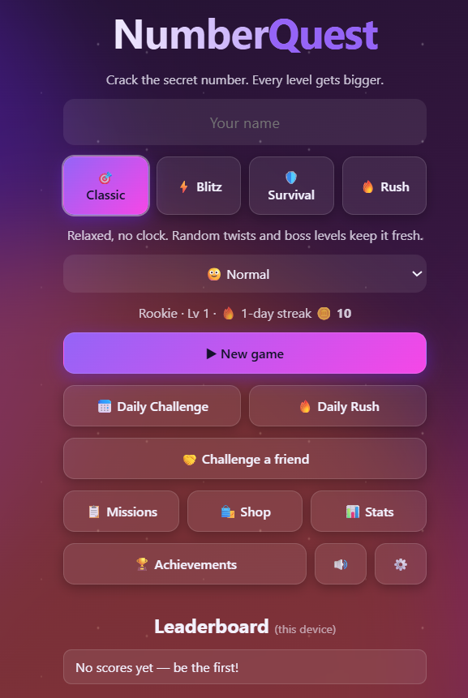
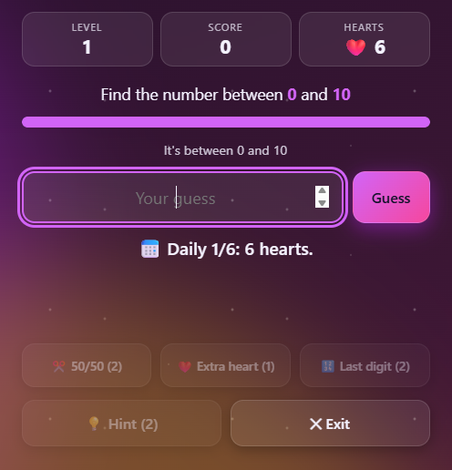

<div align="center">

# 🎯 Number Quest

**Crack the secret number. Every level gets bigger.**

A polished, installable number-guessing game with seven modes, boss levels, achievements, daily challenges and friend challenges. Plain HTML, CSS and JavaScript: no frameworks, no build step, works offline.


**[▶ Play now](https://geuss-game-random-number.netlify.app/)**

</div>

---

## Table of contents
1. [Overview](#overview)
2. [Screenshots](#screenshots)
3. [Game flow](#game-flow)
   - [1. Start game](#1-start-game)
   - [2. Game operation](#2-game-operation)
   - [3. Game over](#3-game-over)
   - [4. Quit game](#4-quit-game)
4. [Game modes](#game-modes)
5. [Difficulty, hearts and levels](#difficulty-hearts-and-levels)
6. [Scoring and rewards](#scoring-and-rewards)
7. [Features](#features)
8. [Achievements and missions](#achievements-and-missions)
9. [Your data and privacy](#your-data-and-privacy)
10. [Project structure](#project-structure)
11. [Getting started](#getting-started)
12. [Deploy on GitHub Pages](#deploy-on-github-pages)
13. [Technologies](#technologies)
14. [Credits](#credits)

---

## Overview
In **Number Quest** the game picks a secret number and you have to find it before you run out of hearts. After each wrong guess you are told whether the guess was too low or too high, and how hot or cold you are. Solve a level to move to a bigger range, earn points and coins, face boss levels and climb the ranks.

Each level gives you just enough hearts for a perfect binary search (always guess the middle of the remaining range) plus a few spares, so the game rewards good strategy, not just luck.

## Screenshots
<div align="center">

| Home menu | Daily Challenge |
|:--:|:--:|
|  |  |
| Pick a mode and difficulty, then jump into a run | A seeded daily level: same numbers for everyone, no hints or power-ups |

</div>

## Game flow

### 1. Start game
- **Goal:** begin a new run.
- **When:** the player picks a mode and difficulty on the home screen and presses **▶ New game** (or **⏩ Continue run** to resume a saved one).
- **How:** the game screen opens with these starting values (Normal difficulty):

| Setting | Starting value |
|---|---|
| Hearts | 6 (scales with the range, see [below](#difficulty-hearts-and-levels)) |
| Score | 0 |
| Level | 1 |
| Secret number | Random, from 0 to 10 (the range grows with each level) |

- **Interaction:** the player types a whole number and presses **Guess** (or Enter).

### 2. Game operation

#### Guessing logic
When the player enters a number and presses **Guess**:

1. **Validation.** The guess must be a whole number inside the current range. Invalid, repeated or already-ruled-out guesses are rejected with a message and **cost no heart**.
2. The guess is compared with the secret number.

**✅ Correct guess**
- The level increases by 1 and the **range grows** (see the [level table](#difficulty-hearts-and-levels)).
- **Points** are awarded for the level, remaining hearts, the optimal-guess streak and any time bonus, then multiplied by the level's twist and the chosen difficulty (see [Scoring](#scoring-and-rewards)).
- 🪙 **Coins** are earned (more on boss levels), and some levels drop a mystery box.
- The **hearts reset** for the next level. The count is recalculated for the new range, and adjusts by ±1 depending on how you just played (more hearts after a close call, fewer after a perfect solve). In Survival mode hearts carry over instead.
- The **guess history is cleared** and a **new secret number** is generated inside the updated range.

**❌ Incorrect guess**
- The player **loses 1 heart**.
- If the guess is too high, the game says **"Too high ↓"**. If it is too low, **"Too low ↑"**. A hot/cold hint (🔥 Burning, ♨️ Hot, 🙂 Warm, ❄️ Cold) is added.
- The known range is narrowed (**"It's between X and Y"**) and a progress bar shows the remaining window.
- A guess very close to the secret earns a small **near-miss bonus (+10)**.
- If the heart count reaches **0**, the run ends (see [Game over](#3-game-over)).

#### Updating chosen numbers
After every guess, the number is stored in the level's guess history and shown as a chip on screen, marked with **↑** (the answer is higher) or **↓** (the answer is lower). This helps the player track previous guesses. The history is cleared at the start of each level.

#### Helpers during a level
- **💡 Hint** (2 per run): tells you whether the number is odd or even.
- **✂️ 50/50**, **❤️ Extra heart** and **🔢 Last digit** power-ups, bought in the shop or found in mystery boxes.
- Hints and power-ups are disabled in the Daily Challenge, Daily Rush and friend challenges, and hints are disabled on boss levels.

#### Twists and bosses
From level 2, a level may roll a twist: **💰 Double Points**, **💖 Second Wind** (+2 hearts), **🌫️ Fog** (the range is hidden) or **⚡ Rush** (beat the clock). Every 5th level is a **👹 Boss**: timed, ×3 points and a bonus box.

### 3. Game over
- **When:** the run ends when the player **runs out of hearts**. In timed modes, running out of time costs a heart, and in Rush mode the run ends when the clock reaches zero.
- **How:**
  - The game reveals the secret number and shows a short pause, then a **summary screen** with: score, level reached, levels cleared, average guesses per level, best streak, time played and coins earned.
  - A new personal record is celebrated with **🏆 New best!**.
  - Scores above zero are added to the on-device **leaderboard** (top 10) and the lifetime **stats**.
  - From the summary the player can choose **Play again**, **📤 Share** the result, or return to the **Menu**.
  - The next run starts fresh: hearts, score, level and range are all reset to their initial values.

### 4. Quit game
- **Goal:** leave the game screen and return to the home menu.
- **When:** the player presses **✕ Exit** during a run.
- **How:**
  - In **Classic, Blitz, Survival and Rush** the run is **saved automatically** after every guess, so the player can come back and press **⏩ Continue run** to resume exactly where they left off.
  - Starting a **New game** replaces the saved run. If the abandoned run had a score, that score is recorded on the leaderboard first.
  - In the **Daily Challenge, Daily Rush and friend challenges** the run cannot be resumed. Exiting asks for confirmation and ends the run; it counts as played and the score so far is recorded.

## Game modes
| Mode | Description |
|---|---|
| 🎯 **Classic** | Relaxed, no clock. Random twists and a boss every 5 levels. |
| ⚡ **Blitz** | A countdown on every level. Fast solves earn bonus points. |
| 🛡️ **Survival** | One heart pool for the whole run. Hearts carry over (+1 per clear, +2 for a perfect solve, max 12). Ranges grow more slowly. |
| 🔥 **Rush** | One 60-second clock for the whole run. Every clear adds time. No twists or bosses. |
| 📅 **Daily Challenge** | Six seeded levels, the same for everyone on the same date. Play once per day. |
| 🔥 **Daily Rush** | A seeded 60-second Rush, once per day. |
| 🤝 **Challenge a friend** | Play a seeded 6-level run, then share the link. Your friend plays the identical numbers and tries to beat your score. |

## Difficulty, hearts and levels
The secret number range grows with each level, and hearts are calculated from the range so a perfect binary search always fits:

`optimal guesses = ⌈log₂(range size)⌉` and `hearts (Normal) = optimal + 2`

**Easy** gives +2 hearts and ×0.8 points, **Hard** gives −2 hearts and ×1.5 points.

| Level | Range | Hearts (Normal) |
|:--:|:--:|:--:|
| 1 | 0 – 10 | 6 |
| 2 | 0 – 25 | 7 |
| 3 | 0 – 50 | 8 |
| 4 | 0 – 100 | 9 |
| 5 | 0 – 250 | 10 |
| 6 | 0 – 500 | 11 |
| 7 | 0 – 1,000 | 12 |
| 8 | 0 – 2,500 | 14 |
| 9 | 0 – 5,000 | 15 |
| 10 | 0 – 10,000 | 16 |
| 11+ | doubles every level | grows by about 1 per level |

*Hearts are adjusted by ±1 depending on your previous level (adaptive difficulty).*

## Scoring and rewards
`points = (100 × level + 25 × hearts left + 50 × streak + 5 × seconds left) × twist multiplier × difficulty multiplier`

- **Streak:** consecutive levels solved in the optimal number of guesses or fewer.
- **Multipliers:** Double Points ×2, Boss ×3, Easy ×0.8, Normal ×1, Hard ×1.5.
- **Coins:** `5 + level` per cleared level (+25 on a boss), plus mystery boxes, mission rewards, a daily login streak bonus and Daily Challenge completion.
- **Ranks:** points also earn XP toward ranks from **Rookie** to **Legend**.

## Features
- 🎮 **7 game modes**, **3 difficulties**, twists, boss levels and a mystery box.
- 🏆 **19 achievements**, **5 daily missions** and a daily login streak.
- 🛍️ **Shop** with colour themes and power-ups, plus a **limited-time seasonal theme** (Winter, Blossom, Summer, Autumn) with falling-particle backgrounds.
- 📊 **Leaderboard** (top 10 on your device), **stats** panel and ranks.
- 💾 **Save and resume**, plus a first-run tutorial and a **How to play** panel.
- 🔊 **Sound:** generated effects, an ambient music pad and boss fanfares, with no audio files. Vibration feedback on phones.
- ⚙️ **Settings:** sound, vibration, music, animated background and **Erase all data**.
- ♿ **Accessible and responsive:** keyboard play (Enter to guess), screen-reader status messages, reduced-motion support, safe-area padding for notched phones, layouts from small phones to desktop.
- 📲 **PWA:** installable and playable offline through a service worker.

## Achievements and missions

**Achievements (19):** 🌱 First Steps · 🍀 Lucky Shot · 😅 Clutch · 🚀 Climber · 🧠 Pure Mind · 💎 High Roller · ⚡ Speed Demon · 👹 Boss Slayer · 📅 Daily Driver · 🎯 Sharp Mind · 🔥 On Fire · 🏔️ Summit · 🛡️ Survivor · 🏃 Rush Hour · 🪙 Coin Hoarder · 🛍️ Shopper · 🎖️ Veteran · 📋 Mission Done · 🍂 Seasonal Spirit

**Daily missions (reset every day, 🪙 30 each):** clear 5 levels · solve 2 levels in the fewest guesses · play today's Daily Challenge · play 3 games · clear 3 levels without hints.

## Your data and privacy
Everything (progress, coins, themes, stats, saves and the leaderboard) is stored **only in your browser** with `localStorage`. Nothing is sent to a server and no account is needed. Use **⚙️ Settings → Erase all data** to reset the game. Because there is no server, the leaderboard is per device, and friend challenges are compared by sharing scores.

## Project structure
```
.
├── index.html              # Page structure and dialogs
├── style.css               # Styling, themes, animated backgrounds
├── game.js                 # All game logic
├── sw.js                   # Offline cache (service worker)
├── manifest.webmanifest    # Install metadata
├── icon.svg                # Vector app icon
├── icon-180.png            # Apple touch icon
├── icon-192.png            # Install icon
├── icon-512.png            # Install icon
├── icon-maskable-512.png   # Maskable install icon
└── README.md
```

## Getting started
The service worker needs `http://`, so use a small local server instead of opening the file directly:

```bash
git clone https://github.com/Kawchar-Ahammed/Guss-Game.git
cd Guss-Game
python3 -m http.server 8000
# open http://localhost:8000
```

## Deploy on GitHub Pages
1. Put all the files at the top level of the repository.
2. Open **Settings → Pages**, choose your branch (`main`) and the `/ (root)` folder, then save.
3. Visit `https://kawchar-ahammed.github.io/Guss-Game/` after a minute or two.
4. When you publish changes, bump the cache name in `sw.js` (for example `nq-v8` → `nq-v9`) so returning players get the update.

## Technologies
HTML5 · CSS3 (custom properties, grid and flexbox, animations) · JavaScript (ES2022) · Web Audio API · `localStorage` · Service Worker and Web App Manifest

## Credits

### 👨‍💻 Author
**Kawchar Ahammed**: concept, design and development
[](https://github.com/Kawchar-Ahammed)

### 🙏 Acknowledgements
- **Game idea:** the classic "guess the number" game, extended with levels, hearts, modes and progression.
- **Strategy:** binary search, the idea behind how many hearts each level gives you.
- **Hosting:** [Netlify](https://www.netlify.com/) and [GitHub Pages](https://pages.github.com/).
- **Badges:** [Shields.io](https://shields.io/).

### 🧰 Built without dependencies
No frameworks, libraries or audio files. Sound effects and music are generated live with the Web Audio API, the app icons were generated by script, and the emoji you see are drawn by your device's own emoji font.

### 💬 Feedback and contributions
Found a bug or have an idea? [Open an issue](https://github.com/Kawchar-Ahammed/Guss-Game/issues) or send a pull request. If you enjoy the game, a ⭐ on the repo is much appreciated!

---

<div align="center">

Made with ❤️ by **Kawchar Ahammed**

</div>
